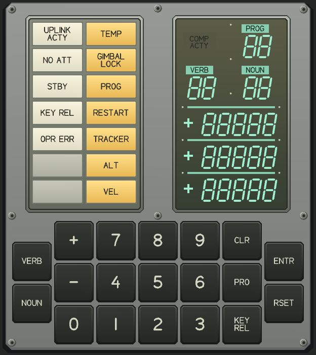

# Apollo 11 Block II AGC

A .NET 10 emulator for the Apollo 11 Lunar Module's Block II Apollo Guidance
Computer and DSKY. It runs the Luminary 099 flight rope with a real-time SDL2
panel for the displays, annunciators, and keypad.

The core models 15-bit one's-complement memory, the 16-bit A/L/Q central
registers, erasable and fixed bank selection, the editing registers, the
Block II basic and extracode instruction set, machine-cycle timing, scaler
driven TIME counters, priority interrupts, and 9-bit I/O channels.

```sh
dotnet build Apollo11.Agc.slnx
dotnet run --project src/Apollo11.Agc -- --dsky
```

The window uses SDL 2.0.18 or newer. On macOS, `brew install sdl2` provides
it. On Linux, install your distribution's SDL2 runtime. On Windows, place the
matching architecture's `SDL2.dll` next to the executable.

Click the keys or use the keyboard. The number row and numeric keypad both work.
Use `V` for VERB, `N` for NOUN, `C` or Backspace for CLR, `K` for KEY REL,
`P` for PRO, `R` for RSET, and `Enter` or `E` for ENTR. Use `+` and `-` for
signs. Holding PRO keeps its discrete input asserted. Escape closes the panel.

Enter `VERB 3 5 ENTR` to run Luminary's lamp test and see the register segments
and annunciators. The panel starts with Luminary's cold-start state and changes
as the flight software writes to the AGC channels.



For headless use, the cycle rate is 85,333⅓ machine cycles per second. Channel 10
relay words and channel 11 lamp words are printed in octal.

```sh
dotnet run --project src/Apollo11.Agc -- --cycles 85333
dotnet run --project src/Apollo11.Agc -- --instructions 1000
```

Rebuild the Luminary rope from the pinned Virtual AGC source with:

```sh
scripts/build-luminary099.sh
```
