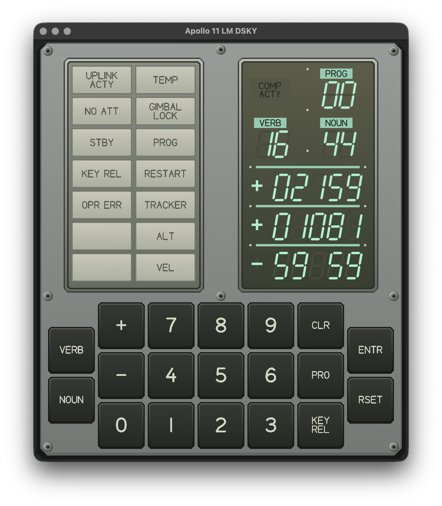

# Apollo 11 Block II AGC

A .NET 10 emulator for the Apollo 11 Lunar Module's Block II Apollo Guidance
Computer and DSKY. It runs the Luminary 099 flight rope with a real-time SDL2
panel for the displays, annunciators, and keypad.

The core models 15-bit one's-complement memory, the 16-bit A/L/Q central
registers, erasable and fixed bank selection, the editing registers, the
Block II basic and extracode instruction set, machine-cycle timing, scaler
driven TIME counters, priority interrupts, and 9-bit I/O channels.

```sh
dotnet build Apollo11.Agc.slnx
dotnet run --project src/Apollo11.Agc
```

The window uses SDL 2.0.18 or newer. On macOS, `brew install sdl2` provides
it. On Linux, install your distribution's SDL2 runtime. On Windows, place the
matching architecture's `SDL2.dll` next to the executable.

Click the keys or use the keyboard. The number row and numeric keypad both work.
Use `V` for VERB, `N` for NOUN, `C` or Backspace for CLR, `K` for KEY REL,
`P` for PRO, `R` for RSET, and `Enter` or `E` for ENTR. Use `+` and `-` for
signs. Holding PRO keeps its discrete input asserted. Escape closes the panel.

Enter `VERB 3 5 ENTR` to run Luminary's lamp test and see the register segments
and annunciators. The panel starts with Luminary's cold-start state and changes
as the flight software writes to the AGC channels.


## Run in a browser

[Open the Apollo 11 DSKY on GitHub Pages](https://jimbojetset.github.io/Apollo11_AGC/).

The `Web/` project runs Luminary 099 and Comanche 055 in Blazor WebAssembly.
It shares the AGC core and Lunar Module panel geometry with the SDL app.
Click or tap the keys or use the same keyboard shortcuts. The emulated clock
pauses while the tab is hidden.

```sh
dotnet workload install wasm-tools
dotnet run --project Web/Apollo11.Agc.Web.csproj
```

Open the local URL printed by the development server. Select the flight
software above the panel. Changing ropes starts a fresh AGC session and
clears the displays and keypad state. `VERB 3 5 ENTR` runs the lamp test.

```sh
dotnet publish Web/Apollo11.Agc.Web.csproj -c Release
```

The published site is in `Web/bin/Release/net10.0/publish/wwwroot`. The GitHub
Pages workflow builds and uploads it when the repository's Pages source is
set to **GitHub Actions**. `Apollo11.Agc.slnx` builds the desktop app and its
tests with the regular .NET SDK.

## Calculate an orbit on the DSKY

Start a fresh Command Module session with Comanche 051 or Comanche 055.
From the project folder, launch the SDL panel with the Comanche rope:

```sh
dotnet run --project src/Apollo11.Agc -- --rope artifacts/Comanche051.bin
```

If you need the rope, run `scripts/build-luminary099.sh` to prepare the pinned
Virtual AGC checkout and yaYUL, then assemble Comanche from that checkout:

```sh
(cd artifacts/virtualagc/Comanche051 && ../yaYUL/yaYUL --parity --unpound-page MAIN.agc)
cp artifacts/virtualagc/Comanche051/MAIN.agc.bin artifacts/Comanche051.bin
```

Replace `Comanche051` with `Comanche055` in these examples to try the version
flown on Apollo 11.

### Load the test state vector

| DSKY keys | Expected response |
| --- | --- |
| `RSET` | Clears the startup RESTART and PROG lamps. |
| `VERB 37 ENTR`, then `00 ENTR` | The PROG display shows `00`. |
| `VERB 71 ENTR` | PROG changes to `27` and flashing `V21 N01` requests the first word. |

Enter the following octal words in order. Press **ENTR after each five-digit
word**. `V21 N01` requests each successive word. After the final word, wait
for flashing `V21 N02`.

| Words to enter | Meaning |
| --- | --- |
| `00021` | Octal component count |
| `01501` | Starting erasable address |
| `00001` | Earth-centred Command Module state vector |
| `00310` `23215` | X position |
| `00000` `00000` | Y position |
| `00000` `00000` | Z position |
| `00000` `00000` | X velocity |
| `23471` `35606` | Y velocity |
| `00000` `00000` | Z velocity |
| `00000` `00000` | State-vector epoch at AGC clock zero |

At `V21 N02`, key `VERB 33 ENTR` to store the vector. PROG returns to `00`.
[Colossus Program 27 listing](https://www.ibiblio.org/apollo/listings/Comanche055/UPDATE_PROGRAM.agc.html)

### Display apogee and perigee

| DSKY keys | Expected response |
| --- | --- |
| `VERB 82 ENTR` | Flashing `V04 N12`. R1 shows `00002` and R2 shows `00001`, which selects the Command Module. |
| Hold `PRO` for about a quarter-second, then release | After a few seconds, `V16 N44` displays the orbit results. |
| `VERB 34 ENTR` | Ends the monitor and returns to the idle P00 display. |

The screenshot shows R1 `+02159` (**215.9 nautical miles apogee**) and R2
`+01081` (**108.1 nautical miles perigee**). R3 `−59 59` indicates that this
orbit never crosses the 300,000-foot reference altitude.
[Colossus R30 listing](https://www.ibiblio.org/apollo/listings/Comanche055/R30.agc.html)



The last digits can vary because Colossus propagates the vector from clock zero
to the time you press `PRO`. To bring the calculation back near the entered
epoch, key `VERB 25 NOUN 36 ENTR` after storing the vector, then enter
`+00000 ENTR` three times for hours, minutes, and seconds. Follow the flashing
`V21 N36`, `V22 N36`, and `V23 N36` prompts, then run `VERB 82` and `PRO`.
[Colossus noun table](https://www.ibiblio.org/apollo/listings/Comanche055/PINBALL_NOUN_TABLES.agc.html)

## Headless use

For headless use, the cycle rate is 85,333⅓ machine cycles per second. Channel 10
relay words and channel 11 lamp words are printed in octal.

```sh
dotnet run --project src/Apollo11.Agc -- --nodsky --cycles 85333
dotnet run --project src/Apollo11.Agc -- --nodsky --instructions 1000
```

Rebuild the Luminary rope from the pinned Virtual AGC source with:

```sh
scripts/build-luminary099.sh
```
